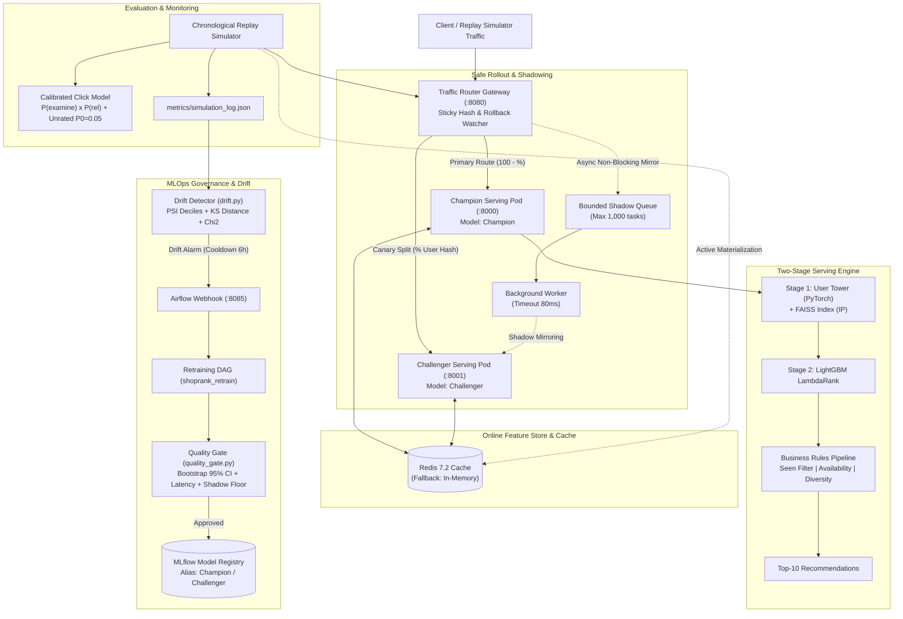

# ShopRank: Two-Stage Recommender with Safe Rollout, Drift Monitoring, and MLOps Lifecycle

**Course Project CS4085 MLOps — Fall 2026**  
**Team**:  
- Muhammad Musab (23L-0806)  
- Shayan Malik (23L-0801)  
- Abubakar Amir (23L-0548)  

---

## Remote Links & Live Ports

| Service | Address / URL | Description / Credentials |
|---|---|---|
| **DagsHub Repository** | [dagshub.com/shayanO-O/shoprank](https://dagshub.com/shayanO-O/shoprank) | DVC remote storage & MLflow remote tracking |
| **GitHub Repository** | [github.com/shayanO-O/shoprank](https://github.com/shayanO-O/shoprank) | Source code, test suites, deployment manifests |
| **Traffic Router Gateway** | `http://localhost:8080` | Entry point for recommendation traffic, canary routing & shadow testing |
| **Champion Serving Pod** | `http://localhost:8000` | Current production two-stage serving container |
| **Challenger Serving Pod** | `http://localhost:8001` | Candidate model serving container |
| **Grafana Dashboards** | `http://localhost:3000` | Real-time observability dashboard (`admin` / `admin`) |
| **Prometheus Server** | `http://localhost:9090` | Time-series metrics collection & alert evaluation |
| **Apache Airflow** | `http://localhost:8085` | Scheduled & drift-triggered DAG orchestration (`admin` / `admin`) |
| **Redis Cache** | `localhost:6379` | Low-latency feature store & interaction cache |

---

## System Architecture



---

## Repository Layout

```
shoprank/
├── dags/                               # Apache Airflow DAG definitions
│   ├── shoprank_dag.py                 # Weekly full pipeline retraining DAG (10 steps)
│   └── shoprank_drift_retrain_dag.py   # Event-driven drift retraining DAG (8 steps)
├── deploy/                             # Containerization & deployment manifests
│   ├── airflow/                        # Custom Airflow Dockerfile & requirements
│   ├── docker-compose.yml              # Multi-container orchestration (7 services)
│   ├── grafana/                        # Pre-provisioned dashboards & datasources
│   ├── k8s/                            # Production Kubernetes manifests (Deployments, Services, HPA)
│   └── prometheus/                     # Prometheus scraping configuration & alert rules
├── docs/                               # Architecture, proposal audits & walkthroughs
│   ├── phase1_walkthrough.md           # Phase 1 pipeline execution walkthrough
│   └── phase2_walkthrough.md           # Phase 2 production architecture & operational runbook
├── metrics/                            # Evaluation reports, drift logs & baseline scores
│   ├── baselines.json                  # Phase 1 offline baseline evaluation
│   ├── results.json                    # Two-stage system offline evaluation
│   ├── simulation_log.json             # Replay simulator logs & feedback events
│   └── drift_report.json               # Statistical PSI / KS drift detection outputs
├── models/                             # Tracked models, indices and atomic manifests
│   ├── manifest.json                   # SHA-256 cryptographic bundle manifest
│   ├── two_tower.pt                    # PyTorch User & Item Tower weights
│   ├── item_embeddings.npy             # 64-dimensional normalized item vectors
│   ├── item_id_map.json                # Logical item ID to matrix index mapping
│   ├── faiss.index                     # Inner Product FAISS retrieval index
│   └── ranker.txt                      # LightGBM LambdaRank trained model
├── notebooks/                          # Google Colab cloud training notebooks
│   └── train_colab.ipynb               # Full end-to-end GPU training workflow
├── scripts/                            # Local operational scripts & test runners
│   ├── run_local.py                    # Standalone end-to-end local system orchestrator
│   └── test_operations_pipeline.py     # Closed-loop DAG, drift & retraining verification
├── src/                                # Core codebase
│   ├── baselines.py                    # Popular, Recent Popular, Co-occurrence, TruncatedSVD
│   ├── build_index.py                  # FAISS index construction from item embeddings
│   ├── config.py                       # Configuration loader & resilient MLflow initialization
│   ├── evaluate.py                     # Offline ranking & retrieval metrics computation
│   ├── preprocess.py                   # Data cleaning, deduplication & parquet conversion
│   ├── ranker.py                       # Stage 2 LightGBM LambdaRank training
│   ├── register.py                     # Atomic bundle packaging & MLflow registration
│   ├── split.py                        # Temporal data splitting (train, ranker, val, test)
│   ├── two_tower.py                    # Stage 1 PyTorch Two-Tower candidate retrieval
│   ├── validate.py                     # Raw dataset schema & boundary validation
│   ├── monitoring/                     # Statistical drift detection & governance
│   │   └── drift.py                    # PSI (deciles), KS distance, Chi-Square, Cooldown
│   ├── pipeline/                       # Pipeline runners & governance gates
│   │   ├── quality_gate.py             # Bootstrap 95% CI statistical promotion gate
│   │   └── run_pipeline.py             # CLI pipeline runner matching Airflow task graphs
│   └── serving/                        # Production real-time serving infrastructure
│       ├── app.py                      # FastAPI serving engine with bundle validation
│       ├── business_rules.py           # Seen filter, availability delisting, diversity cap
│       ├── feature_store.py            # Point-in-time online store (Redis / In-Memory)
│       ├── metrics_exporter.py         # Prometheus metrics instrumentation
│       ├── router.py                   # Sticky hashing, async shadow queue, rollback watcher
│       └── simulator.py                # Chronological replay simulator & click model
├── tests/                              # 10 test suites (52 tests passed)
│   ├── test_api.py                     # FastAPI endpoints & manifest checksum tamper tests
│   ├── test_deploy.py                  # Dockerfile, Compose, K8s, Prometheus syntax tests
│   ├── test_drift.py                   # PSI, KS test, negative/positive controls, cooldown
│   ├── test_metrics.py                 # NDCG, Recall, Coverage, Diversity, Latency unit tests
│   ├── test_prerequisites.py           # Cold item projections, diversity, availability, hashes
│   ├── test_quality_gate.py            # Bootstrap CI, tie-breakers, latency failure, acyclic DAG
│   ├── test_router.py                  # Sticky hash partitioning, shadow worker, auto-rollback
│   ├── test_serving.py                 # Point-in-time anti-leakage, Redis fallback, business rules
│   ├── test_simulator.py               # Examination decay, relevance calibration, drift injection
│   └── test_split.py                   # Temporal ordering without lookahead bias
├── dvc.yaml                            # DVC pipeline specification
├── params.yaml                         # Global hyperparameters & serving configurations
└── pyproject.toml                      # Project metadata, pytest & tool configuration
```

---

## Phase 1: Two-Stage Recommender & Offline Evaluation

Phase 1 established the core ML pipeline, strictly versioned with DVC and tracked with MLflow on DagsHub.

### Pipeline Highlights
- **Strict Temporal Splitting**: Prevents future lookahead bias. Sorted by timestamp into Train (60%), Ranker (20%), Validation (10%), and Test (10%).
- **Cold-Start Safeguards**: Cold users in validation/test sets with no training history are flagged and evaluated separately to ensure cold-start fallback resilience.
- **Four Classical Baselines**:
  1. *Popular Overall*: Global highest interaction frequency.
  2. *Recent Popular*: Top items in the most recent time window.
  3. *Item Co-occurrence*: Frequently interacted together.
  4. *Matrix Factorization*: TruncatedSVD decomposition on the sparse user-item interaction matrix.
- **Stage 1 Candidate Retrieval (Two-Tower)**: PyTorch User Tower and Item Tower mapping users and items into a 64-dimensional normalized inner-product embedding space. Candidate items are indexed with FAISS for sub-millisecond retrieval of the top 50 candidates.
- **Stage 2 Re-Ranking (LightGBM LambdaRank)**: Re-ranks top-50 candidates down to top-10 using interaction histories, cosine similarity features, popularity scores, item genres, and release years.

### Offline Evaluation Benchmark

All metrics evaluated on unseen temporal test splits:

| Model | Val NDCG@10 | Val Recall@50 | Test NDCG@10 | Test Recall@50 | Catalog Coverage | Diversity |
|---|---|---|---|---|---|---|
| Popular Overall | 0.2735 | 0.1623 | - | - | 0.0156 | 0.7277 |
| Recent Popular | 0.3070 | 0.1997 | - | - | 0.0100 | 0.6733 |
| Item Cooccurrence | 0.3052 | 0.1969 | - | - | 0.0293 | 0.6746 |
| Matrix Factorization | 0.3077 | 0.1985 | - | - | 0.0619 | 0.6713 |
| Retrieval Only | 0.2656 | 0.1563 | 0.2544 | 0.1421 | 0.1879 | 0.7036 |
| **Retrieval + Ranker** | **0.3299** | **0.1873** | **0.3203** | **0.1751** | **0.1051** | **0.6523** |
| Cold Start Only | 0.3757 | 0.2083 | 0.3564 | 0.1927 | 0.0010 | 0.6662 |

*Metrics Definition*:
- **NDCG@10**: Normalized Discounted Cumulative Gain measuring ranking relevance within the top 10 items.
- **Recall@50**: Fraction of ground-truth test items captured in the 50 candidate retrieval pool.
- **Catalog Coverage**: Proportion of distinct catalog items recommended across all users.
- **Intra-List Diversity**: Mean pairwise cosine distance between recommended items based on genre vectors.

---

## Phase 2: Production Serving, Safe Rollout, Drift Monitoring & MLOps

Phase 2 elevates the offline system into a high-throughput, low-latency, resilient production platform.

### 1. Atomic Model Bundles & Cryptographic Integrity
- **Manifest Governance** (`src/register.py`): Models are packaged atomically into bundles comprising `two_tower.pt`, `item_embeddings.npy`, `item_id_map.json`, `faiss.index`, and `ranker.txt`.
- **Integrity Verification** (`src/serving/app.py`): `models/manifest.json` stores individual SHA-256 hashes and a master `bundle_hash`. On container startup, every artifact is re-hashed. Tampered, missing, or mismatched weights fail fast with `HTTP 503` / `ValueError`, preventing silent serving corruption.
- Metadata is queryable via `/version` and readiness is reported via `/ready`.

### 2. Low-Latency Serving API
- **FastAPI Serving Engine** (`src/serving/app.py`): Meets strict $<30\text{ms}$ p95 latency SLAs.
- **REST Endpoints**:
  - `POST /recommend`: Accepts `user_id`, optional `top_k`, and optional `as_of` timestamp.
  - `POST /feedback`: Ingests real-time interaction feedback (clicks, conversions, ratings).
  - `GET /healthz`: Fast liveness check.
  - `GET /ready`: Bundle loaded & integrity verified check.
  - `GET /version`: Active model alias, version string, and SHA-256 bundle hash.
  - `GET /metrics`: Prometheus scraping endpoint.

### 3. Point-in-Time Online Feature Store & Business Rules
- **Redis + In-Memory Fallback** (`src/serving/feature_store.py`): Backed by Redis 7.2 with seamless automatic fallback to in-memory store if Redis is unavailable.
- **Anti-Leakage Temporal Safety**: `get_user_history(user_id, as_of=t)` strictly filters interactions where `timestamp <= t`. Historical simulation replays never leak future interactions.
- **Business Rules Pipeline** (`src/serving/business_rules.py`):
  1. *Seen Item Filter*: Removes items previously interacted with by the user.
  2. *Availability Delisting*: Delists out-of-stock / unstreamable items dynamically using `data/availability.parquet`.
  3. *Category Diversity Enforcement*: Enforces intra-list genre diversity by capping dominant genres at `max_per_genre = 3`.
  4. *Cold-Start Fallback*: Unseen users seamlessly receive recent popular items projected through cold-start embedding heuristics.

### 4. Traffic Router & Safe Rollouts
- **Sticky Session Canary Routing** (`src/serving/router.py`): Deterministic user hash partitioning ensures users consistently see the same model version throughout their session:
  $$\text{SHA256}(\text{user\_id} : \text{salt}) \pmod{100} < \text{canary\_weight}$$
- **Zero-Risk Asynchronous Shadow Traffic**: Clones primary requests into a bounded queue (`maxsize=1000`). A dedicated background worker forwards mirrored requests to Challenger with an 80ms timeout. Challenger failures or latency spikes never affect user responses.
- **Automated Rollback Watcher**: Continuously monitors sliding-window error rates and p95 latencies. If Challenger error rate exceeds 1% or latency exceeds 30ms, the router automatically drops `canary_weight` to 0.

### 5. Chronological Replay Simulator & Calibrated Click Model
- **Replay Simulator** (`src/serving/simulator.py`): Replays production interaction logs chronologically through the router gateway.
- **Calibrated Click Model**: Computes realistic user clicks combining position-dependent examination decay and relevance probabilities:
  $$P(\text{click} \mid \text{pos}, \text{rel}) = P(\text{examine} \mid \text{pos}) \times P(\text{rel})$$
  Includes an unrated background click floor ($P_0 = 0.05$) to model real-world discovery.
- Injects controlled item popularity drift and category interest shifts to test monitoring alarms.

### 6. Statistical Drift Detection & Cooldown
- **Statistical Tests** (`src/monitoring/drift.py`):
  - *Item Popularity Drift*: Decile-based Population Stability Index (PSI). Flags warning at $\text{PSI} \ge 0.10$ and drift at $\text{PSI} \ge 0.20$.
  - *Score Distribution Drift*: Two-sample Kolmogorov-Smirnov (KS) test on model output probabilities. Flags drift at $p < 0.05$ and $\text{statistic} \ge 0.10$.
  - *Genre Categorical Drift*: Chi-Square goodness-of-fit test comparing observed vs baseline category distributions.
- **Retraining Cooldown**: Enforces a 6-hour cooldown window between automated retraining runs to prevent flapping or wasted compute during ongoing traffic shifts.
- **Negative Control Verification**: Verified that unshifted baseline traffic produces zero false alarms ($\text{PSI} < 0.02$).

### 7. Statistical Quality Gate
- **Bootstrap 95% Confidence Interval** (`src/pipeline/quality_gate.py`): Candidate Challenger models must statistically outperform the Champion on NDCG@10 by a minimum margin ($+0.005$) with 95% bootstrap confidence ($p \ge 0.95$).
- **Multi-Constraint Enforcement**:
  - Recall@50 non-regression constraint.
  - p95 inference latency $\le 30\text{ms}$.
  - Shadow verification floor: Minimum 100 shadow requests, $\ge 90\%$ recommendation agreement, and $< 1\%$ error rate.

### 8. Apache Airflow Orchestration & Resilient Backend
- **Airflow DAGs** (`dags/`):
  - `shoprank_training_pipeline`: Scheduled weekly 10-step full pipeline (validation $\to$ preprocessing $\to$ split $\to$ baselines $\to$ two-tower $\to$ FAISS $\to$ ranker $\to$ evaluate $\to$ register $\to$ quality gate).
  - `shoprank_retrain`: Event-driven 8-step retraining pipeline triggered automatically via webhook when drift is detected.
- **Self-Healing MLflow Tracking**: Configured with dual tracking: attempts remote DagsHub logging, and automatically falls back to local SQLite storage (`sqlite:///mlruns.db`) when remote credentials or tokens are restricted.

---

## System Verification & Test Suites

The codebase includes 10 pytest test suites covering 52 unit and integration tests:

| Test Suite | Tests | Scope & Validated Behaviors |
|---|---|---|
| `test_api.py` | 7 | Healthz, ready, version, recommend, feedback, metrics, manifest checksum tamper rejection |
| `test_deploy.py` | 5 | Dockerfile, docker-compose services, Prometheus scrape configs, K8s manifests, CI workflows |
| `test_drift.py` | 6 | PSI stability, negative control (no false alarms), positive control, KS score drift, retraining cooldown, Grafana JSON |
| `test_metrics.py` | 5 | NDCG@k, Recall@k, catalog coverage, intra-list diversity, latency percentiles |
| `test_prerequisites.py` | 4 | Cold-start metadata projection, diversity enforcement, catalog availability, file SHA-256 hashes |
| `test_quality_gate.py` | 7 | Bootstrap 95% CI, tie rejection, latency SLA violation, shadow sample size & error rate, acyclic DAG |
| `test_router.py` | 5 | Sticky hash user partitioning, router status/config, auto-rollback on error/latency, routing endpoints |
| `test_serving.py` | 7 | Point-in-time timestamp queries (`as_of`), feature store materialization, cold user fallback, business rules pipeline |
| `test_simulator.py` | 4 | Examination decay curve, calibrated click relevance, popularity drift injection, in-process replay |
| `test_split.py` | 2 | Temporal split order preservation, zero future lookahead bias, cold-user flagging |
| **Total** | **52** | **100% Passed** |

Execute the entire suite with:
```bash
pytest tests/ -v
```

---

## Production Deployment Stack

The full production environment is managed with Docker Compose (`deploy/docker-compose.yml`) containing 7 coordinated containers:

| Container Name | Service | Port | Healthcheck |
|---|---|---|---|
| `shoprank-router` | Traffic Router Gateway | `8080` | `curl -f http://localhost:8080/healthz` |
| `shoprank-champion` | Champion Serving Pod | `8000` | `curl -f http://localhost:8000/healthz` |
| `shoprank-challenger` | Challenger Serving Pod | `8001` | `curl -f http://localhost:8001/healthz` |
| `shoprank-redis` | Redis Cache 7.2 | `6379` | `redis-cli ping` |
| `shoprank-prometheus` | Prometheus Monitoring | `9090` | `wget -q --spider http://localhost:9090/-/healthy` |
| `shoprank-grafana` | Grafana Dashboards | `3000` | `wget -q --spider http://localhost:3000/api/health` |
| `shoprank-airflow` | Airflow Webserver & Scheduler | `8085` | `curl -f http://localhost:8085/health` |

For cloud-native environments, production Kubernetes manifests are provided in `deploy/k8s/`:
- `configmap.yaml`: Shared serving and routing environment variables.
- `champion-deployment.yaml`: Replicated Champion deployment with readiness/liveness probes and HPA.
- `challenger-deployment.yaml`: Independent Challenger deployment with isolated resource limits.
- `router-deployment.yaml`: Gateway deployment routing ingress traffic between pods.
- `hpa.yaml`: Horizontal Pod Autoscaler targeting 70% CPU utilization and 25ms p95 latency.

---

## Step-by-Step Reproduction Guide & Operational Runbook

### Step 1: Environment Setup & Data Pull

```bash
# 1. Clone repository
git clone https://github.com/shayanO-O/shoprank.git
cd shoprank

# 2. Create virtual environment and install dependencies
python3 -m venv .venv
source .venv/bin/activate
pip install -r requirements.txt

# 3. Configure credentials
cp .env.example .env
# Optional: Add DAGSHUB_USER_TOKEN to .env for remote sync

# 4. Pull versioned datasets and model weights via DVC
dvc pull
```

### Step 2: Run Unit and Integration Tests

Run all 52 test cases verifying APIs, routers, drift detection, and pipelines:
```bash
pytest tests/ -v
```

### Step 3: Standalone Local Runner

To execute the entire serving engine, traffic router, shadow worker, and simulation loop locally without Docker:
```bash
python scripts/run_local.py
```
This boots Champion (:8000), Challenger (:8001), and Router (:8080) as background processes, runs a 100-request simulation pass, verifies metrics, and shuts down cleanly.

### Step 4: Launch Full Production Stack via Docker Compose

Start all 7 containers in detached mode:
```bash
docker compose -f deploy/docker-compose.yml up -d
```

Verify service statuses:
```bash
docker compose -f deploy/docker-compose.yml ps
```

### Step 5: Verify Serving Endpoints & Router Gateway

```bash
# Check router health & current routing configuration
curl -s http://localhost:8080/healthz | jq
curl -s http://localhost:8080/status | jq

# Request recommendations through the gateway for User 42
curl -s -X POST http://localhost:8080/recommend \
  -H "Content-Type: application/json" \
  -d '{"user_id": 42, "top_k": 10}' | jq

# Update canary traffic to 20% Challenger
curl -s -X POST http://localhost:8080/config \
  -H "Content-Type: application/json" \
  -d '{"canary_weight": 20}' | jq

# Ingest user feedback
curl -s -X POST http://localhost:8080/feedback \
  -H "Content-Type: application/json" \
  -d '{"user_id": 42, "item_id": 110, "rating": 5.0, "timestamp": 1700000000}' | jq
```

### Step 6: Closed-Loop Operations Verification

Verify the entire MLOps operational loop (Airflow DAG dry-runs, drift webhook triggers, automated smoke retraining, bundle registration, and quality gate evaluation):
```bash
python scripts/test_operations_pipeline.py
```

### Step 7: Replay Simulation & Drift Injection

Replay 2,000 requests with calibrated clicks and dynamic popularity drift:
```bash
python src/serving/simulator.py --n-requests 2000 --drift-ratio 0.25 --endpoint http://localhost:8080/recommend
```

### Step 8: Statistical Drift Detection & Alerting

Analyze production logs against baseline distributions:
```bash
python src/monitoring/drift.py \
  --baseline data/processed/interactions_train.parquet \
  --current metrics/simulation_log.json \
  --output metrics/drift_report.json
```
If drift is detected ($\text{PSI} \ge 0.20$), the script triggers the Airflow webhook:
```
http://localhost:8085/api/v1/dags/shoprank_retrain/dagRuns
```

### Step 9: Monitor Live Metrics in Prometheus & Grafana

- Open Prometheus: `http://localhost:9090` (inspect `shoprank_recommendation_requests_total`, `shoprank_recommendation_latency_seconds_bucket`, `shoprank_cache_hits_total`).
- Open Grafana: `http://localhost:3000` (Login: `admin` / `admin`).
- Navigate to the pre-provisioned **ShopRank Model Serving & Drift Monitoring** dashboard to observe:
  - Recommendation Request Rate (split by model version).
  - P50, P90, P95, P99 Latency percentiles.
  - Active Canary Weight vs Shadow Worker Traffic.
  - Feature Store Cache Hits (Redis vs In-Memory).
  - Shadow Queue Size & Worker Error Rate.

---

## Limitations & Edge Cases Handled

1. **Cold Users**: Users without prior interactions receive recent popular items and are tagged with `cold_user: true` in metadata.
2. **Cold Items**: Items with missing ID embeddings are projected via genre multi-hot vectors and release year features directly into the shared embedding space (`id_dropout=0.1`).
3. **Temporal Leakage**: Strict `as_of` timestamp querying prevents future interactions from contaminating feature store lookups during backtesting and simulations.
4. **Corrupted Model Defense**: Cryptographic SHA-256 verification in `models/manifest.json` ensures mismatched or corrupt weights fail during startup rather than serving silently degraded recommendations.
5. **Circuit Breaking / Auto-Rollback**: Bounded shadow queuing prevents memory exhaustion, and automated latency/error thresholds immediately reset canary traffic to 0 upon anomaly detection.
